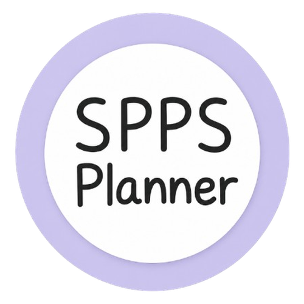

<div align="center">



# SPPS Planner v7.0.0

**고체상 펩타이드 합성(SPPS)의 계획·계산·Batch 준비·Cleavage/Workup·실험 근거 확인을 지원하는 Windows 중심 데스크톱 프로그램**

Project Manager · Exact bottle setup · Editable Plan · Materials · Checklist · Batch Manager · Loading · Cleavage · Workup · Experimental History

[](VERSION)
[](requirements.txt)
[](#빠른-시작)

**[English README](README.md) · [한국어 사용자 매뉴얼](docs/USER_MANUAL_KO.md) · [English User Manual](docs/USER_MANUAL_EN.md)**

Repository: **SanghunWoo-23/SPPS-PLANNER**

</div>

> **현재 공개 버전: v7.0.0 Final R2.**  
> GitHub 배포 ZIP은 프로그램 기능 변경 없이 패키징 문제만 수정한 revision이 추가될 수 있습니다.

---

## SPPS Planner란?

SPPS Planner는 **고체상 펩타이드 합성(SPPS)** 조건을 설정하고 계산 결과를 한곳에서 관리하기 위한 데스크톱 작업 도구입니다.

V7의 중심 흐름은 **Project Manager**입니다.

```text
Add / Edit peptide
      ↓
Sequence + Scale + Resin + Loading + Exact bottles
      ↓
Generate
      ↓
Plan
 ├─ Materials
 ├─ Checklist
 ├─ Total Materials
 ├─ Cleavage Cocktail
 └─ Workup
      ↓
Batch Manager / Experimental records / Recommendations
```

V7은 기존 검증된 계산 동작을 유지하면서 실제 사용 흐름을 단순화하고 입력 오류를 줄이는 데 초점을 두었습니다.

---

## 주요 기능

### Project Manager Add / Edit

각 peptide에 다음 조건을 저장할 수 있습니다.

- Project / Peptide name
- Sequence
- Scale / Copies
- Resin / Loading
- LOT No.
- Coupling reagent / activator
- Additive / catalyst
- Base
- Solvent

Reagent library에서 정확한 bottle identity를 선택하거나 직접 입력할 수 있습니다.

### My recipes

자주 사용하는 coupling 조합을 로컬에 저장할 수 있습니다.

지원 기능:

- Save
- Load
- Rename
- Delete
- Favorite
- Backup / Import
- 최근 recipe / 최근 bottle 바로가기

### 결과 통합 계산

`Generate`를 실행하면 현재 peptide 조건을 기준으로 다음 결과가 함께 갱신됩니다.

- Plan
- Materials
- Checklist
- Total Materials
- Cleavage Cocktail
- Workup

Plan을 직접 수정한 경우에는 기존 Apply Change workflow로 현재 수정값을 유지하면서 연동 결과를 다시 계산할 수 있습니다.

### 2-CTC Direct loading

**2-CTC**를 선택하면 Direct resin loading이 자동으로 활성화됩니다.

기본 loading 조건:

```text
Resin        1 eq
Amino acid   2 eq
DIEA         4 eq
```

이미 loading 된 2-CTC resin을 사용하는 경우 사용자가 직접 체크를 해제할 수 있습니다.

다른 resin은 Direct loading이 자동 적용되지 않습니다.

### Cleavage / Workup

Cleavage 계산은 Project Manager 결과 탭과 연결되어 있습니다.

Post-cleavage workup 선택:

- Ethyl Ether
- n-Hexane
- Ether / n-Hexane 1:1
- 실제 사용 volume 직접 입력

Workup solvent는 cleavage cocktail과 별도로 관리되며 Materials / Total Materials에도 반영됩니다.

### Batch Manager

Batch Manager는 Project Manager의 실제 peptide sequence를 읽어 solution preparation 양을 계산합니다.

Project별 coupling bottle 설정이 Batch Manager의 preparation default를 자동으로 덮어쓰지 않습니다.

---

## 빠른 시작

### 권장 환경

- Windows 10 / 11
- 64-bit Python 3.11 또는 3.12
- Tk 사용이 가능한 Python 환경

### 소스에서 실행

Repository root에서:

```bat
python -m venv .venv
.venv\Scripts\activate
python -m pip install --upgrade pip
python -m pip install -r requirements.txt
python main_launcher.py
```

### Windows EXE / Installer 만들기

배포 패키지에는 Windows build에 필요한 파일이 포함되어 있습니다.

가장 간단한 방법:

```bat
INSTALL_BUILD_TOOLS_AND_BUILD.bat
```

개별 실행도 가능합니다.

```bat
BUILD_EXE_ONLY.bat
BUILD_INSTALLER.bat
```

`INSTALL_BUILD_TOOLS_AND_BUILD.bat`은 `requirements-dev.txt`를 사용하며, build 가능한 Release 패키지에는 해당 파일이 포함되어 있습니다.

---

## Public 데이터 정책

GitHub Public 패키지에는 다음 자료를 포함하지 않습니다.

- Private 실험 이력
- 내부 실험 DB
- 기밀 sample / sequence 정보
- 원본 실험 사진
- Private model artifact
- 사용자 runtime/export 데이터

사용자가 직접 보유하고 사용 권한이 있는 데이터만 로컬로 추가하거나 공개해야 합니다.

---

## 과학적 사용 범위

SPPS Planner는 연구 계획, 계산, 기록 및 의사결정 보조를 위한 프로그램입니다.

다음을 대체하지 않습니다.

- 승인된 SOP
- SDS 및 기관 안전 규정
- 숙련된 작업자의 판단
- 검증된 분석법
- 실제 합성 결과 확인
- 필요한 경우의 GMP/GLP 공식 문서

Recommendation은 표시된 근거와 provenance를 함께 확인해야 합니다.

---

## License / Citation

전체 라이선스 조건은 [LICENSE](LICENSE)를 확인하십시오.

학술 연구에서 SPPS Planner를 사용한 경우 software와 해당 tagged release를 인용해 주십시오.

권장 표기:

> Woo, S. **SPPS Planner: Solid-Phase Peptide Synthesis Planning and Evidence-Driven Decision Support.** Version 7.0.0. GitHub repository, 2026.

Citation metadata는 [CITATION.cff](CITATION.cff)를 참고하십시오.
