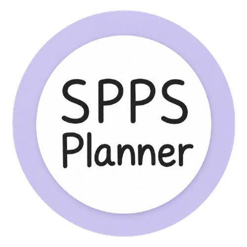

<div align="center">



# SPPS Planner V9.0.0

**펩타이드 SPPS 계획·물질 계산·실험 근거 검토를 위한 Windows 중심 연구용 프로그램**

[English](README.md) · [한국어 사용자 매뉴얼](docs/USER_MANUAL_KO.md) · [V9 개발 범위](README_V9_DEVELOPMENT.md)

</div>

> **개발 소스 후보입니다.** ZIP에는 Python 소스와 Windows 빌드 입력 파일이 포함됩니다.
> 실행 EXE·Installer가 포함된 정식 설치 패키지가 아닙니다. 계산과 AI 결과는
> 실험자 검토와 실제 분석·재현성 시험이 필요합니다.

**문서 안내:** [현재 사용법·파일 구성](docs/INDEX.md).

## 현재 주요 기능

- Project Manager, 편집 가능한 Plan/Materials/Checklist, Batch Manager 및 Auto Plan 검토
- 지원되는 보호형·Lys Branch·Head-to-tail 구조의 단계별 이론 MW 확인
- 명시적인 원자 매핑이 있는 Monomer와 Branch/Cyclic의 RDKit 구조 교차검증
- Excel/CSV 여러 파일·시트의 승인형 가져오기, 데이터 품질 감사, 탐색적 ML 수득률·순도 분석
- 로컬 PDF/텍스트 문헌 근거 검색 및 사용자 동의 후 발췌문 AI 검토
- 비동기 학습·중단과 독립 실험 데이터 기반 ML 평가 도구

**현재 제한:** 구조를 계산할 수 있다고 실제 반응 성공·선택성·수득률이 검증되는 것은
아닙니다. 외부 실험 데이터 예측 성능과 Windows 네이티브 설치 성공 결과는 확보되지 않았습니다.

## 소스 실행

Python **3.11/3.12**, Tkinter가 필요합니다.

```bash
python -m venv .venv
# Windows: .venv\\Scripts\\activate   |   Linux: source .venv/bin/activate
python -m pip install -r requirements.txt
python main_launcher.py --self-test
python main_launcher.py
```

RDKit은 기본 `requirements.txt`에 이미 포함됩니다. 별도
`requirements-rdkit-optional.txt` 재설치는 필요하지 않습니다.

Windows EXE/Installer 빌드용 통합 BAT: `INSTALL_BUILD_TOOLS_AND_BUILD.bat`.
단, Windows에서 실제 빌드·설치·삭제 시험을 해야 정식 배포를 판정할 수 있습니다.

## GitHub 공개 사전 검사

```bash
python tools/github_release_preflight_v9.py --strict
python -m pytest -q tests/test_v9_github_public_preflight.py
python tools/build_github_source_release_v9.py --output ../SPPS_Planner_V9.0.0_PUBLIC_SOURCE.zip
```

공개 전 실제 파일 목록과 SHA-256, Private 실험 시드·학습 모델·로컬 DB 혼입 여부를
검사합니다. GitHub Actions의 해당 워크플로우는 **다운로드 가능한 소스 ZIP을
Artifact로만 만듭니다**. GitHub Release 자동 공개나 기존 브랜치 덮어쓰기는 하지 않습니다.

자세한 방법은 [GitHub 공개 가이드](docs/GITHUB_PUBLICATION_V9_KO.md)를 참고하세요.

## 공개/라이선스 원칙

- **Public 소스만 GitHub에 공개**하며, Private 소스·실험 데이터·사용자 프로젝트는 공개하지 않습니다.
- 현재 라이선스는 **비상업적 연구 및 학술 인용을 요구하는 사용자 정의 소스 공개 라이선스**이며,
  **OSI 승인 오픈소스 라이선스가 아닙니다.** [LICENSE](LICENSE)와 [CITATION.cff](CITATION.cff) 확인.
- AI는 합성 조건의 검증된 SOP를 자동 확정하지 않습니다.

**저장소:** https://github.com/SanghunWoo-23/SPPS-PLANNER
